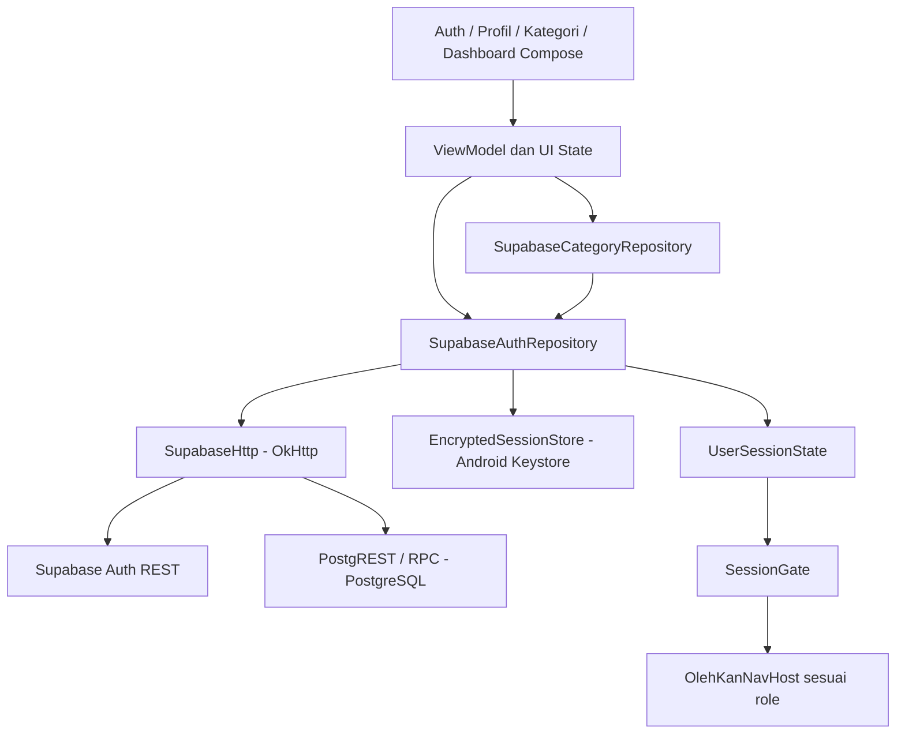
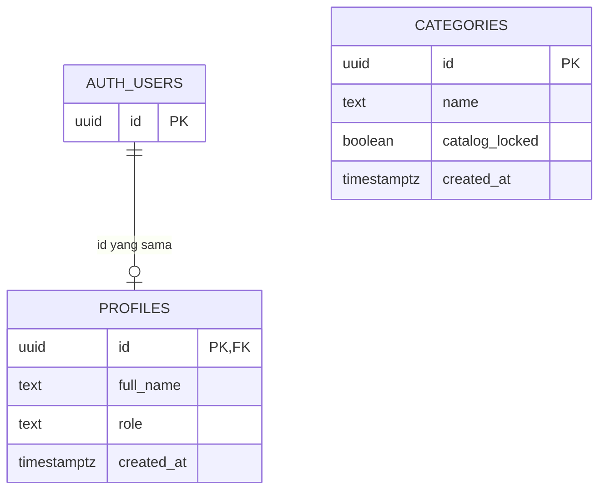
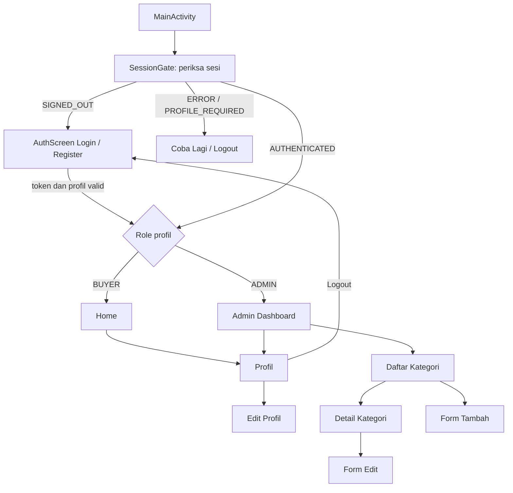

# DOKUMENTASI FITUR OLEHKAN

Dokumentasi implementasi berdasarkan source code yang diperiksa pada 23 November 2026.

> Status bukti: struktur dan perilaku di bawah ditelusuri dari kode Android, konfigurasi Gradle, SQL, dan kode pengujian. Isi database serta pengaturan Supabase Dashboard tidak diperiksa langsung. Pengguna menginformasikan migrasi sudah dijalankan. Keberhasilan koneksi dan alur Supabase nyata tetap perlu pengujian manual.

## 1. Pendahuluan

OlehKan adalah aplikasi Android untuk menjelajahi dan membeli produk oleh-oleh dari **satu toko**. Aplikasi bukan marketplace multi-vendor: tidak ada pendaftaran toko, pemilihan penjual, atau role seller terpisah.

Dua role yang didukung:

| Role | Tanggung jawab dan akses |
| --- | --- |
| ADMIN | Mengakses dashboard, mengelola kategori yang tidak dilindungi, dan mengelola nama profil sendiri. |
| BUYER | Membuka Home, menjelajahi produk, menggunakan fitur belanja yang tersedia, dan mengelola nama profil sendiri. |

Dokumen ini menjelaskan login/register, autentikasi Supabase, profil, pembatasan role, dashboard admin, CRUD kategori, integrasi database, sesi, navigasi, dan hubungan dengan modul kelompok.

**Batas domain:** nama tugas “Manajemen Kategori / Stok Bahan” direalisasikan sebagai **manajemen kategori produk**. Tidak ditemukan entity bahan baku, transaksi stok masuk/keluar, atau sistem inventori lengkap. `Product.category` adalah nama kategori berbentuk `String`; `Product.stock` adalah jumlah stok produk dalam katalog dummy. Kategori dan jumlah stok merupakan dua data berbeda.

### Status implementasi singkat

| Bagian | Kondisi dalam source code |
| --- | --- |
| Login, register, sesi, profil | Terhubung ke endpoint REST Supabase; bukan UI dummy. |
| Dashboard | Mengambil jumlah kategori dan buyer melalui RPC; menyediakan akses kategori/profil. |
| CRUD kategori | Menggunakan tabel Supabase `categories` dan cache `StateFlow`. |
| Katalog produk, detail, pencarian | Menggunakan `DummyProductRepository`. |
| Wishlist | Penyimpanan memori; belum persisten per akun. |
| Checkout, pesanan, ulasan | Screen placeholder; belum transaksi database. |
| Upload gambar | Belum ditemukan implementasi upload. Gambar produk berupa URL yang ditampilkan dengan Coil. |

Status kode tersedia tidak sama dengan bukti semua alur berhasil terhadap server nyata.

## 2. Teknologi yang Digunakan

Sumber versi: [version catalog](../gradle/libs.versions.toml), [Gradle aplikasi](../app/build.gradle.kts), dan [settings Gradle](../settings.gradle.kts).

| Teknologi | Versi/konfigurasi yang ditemukan | Fungsi dalam project |
| --- | --- | --- |
| Kotlin | Entri `kotlin = 2.2.10` pada catalog dipakai plugin Compose | Bahasa source aplikasi. Angka ini merupakan versi konfigurasi plugin Compose, bukan hasil audit compiler yang di-resolve AGP. |
| Android Gradle Plugin | 9.5.2 | Build satu module Android `:app`. |
| Android SDK | minSdk 27; compileSdk/targetSdk 37 | Batas perangkat dan target API. |
| Jetpack Compose | BOM 2026.02.01 | UI deklaratif; daftar kategori dan dashboard menggunakan `LazyColumn`. BOM mengatur versi library Compose. |
| Material 3 | Mengikuti BOM | Field, tombol, dialog, card, dan tema UI. |
| Activity Compose | 1.13.0 | Entry point Compose dan penanganan edge-to-edge. |
| Lifecycle / ViewModel Compose | 2.11.0 | `ViewModel`, scope coroutine, dan observasi state sesuai lifecycle. |
| Navigation Compose | 2.9.5 | `NavHost`, route string, argumen ID, dan back stack. |
| Kotlin coroutines / StateFlow | Dipakai dalam kode; catalog mencantumkan 1.9.0 | Operasi asynchronous dan state observable. Alias coroutines tidak dipasang langsung di dependencies `app`; jangan menganggap angka catalog sebagai versi runtime terverifikasi. |
| OkHttp | 4.12.0 | Request HTTPS ke Supabase Auth dan REST database. |
| `org.json` | API platform Android | Membaca/menulis JSON, tanpa serializer tambahan. |
| Supabase Auth | REST API `/auth/v1` | Akun, password login, refresh token, identitas pengguna, logout. |
| Supabase Data API / PostgreSQL | Versi server tidak diketahui | Tabel `profiles`, `categories`, RLS, trigger, dan RPC. |
| Android Keystore + SharedPreferences | API Android | Enkripsi token sesi AES/GCM dan penyimpanan ciphertext. |
| Coil Compose | 2.7.0 | Memuat gambar katalog dari URL; tidak menyediakan alur upload dalam implementasi ini. |
| JUnit / AndroidX Test / Compose UI Test | JUnit 4.13.2; AndroidX JUnit 1.3.0; Espresso 3.7.0; Compose mengikuti BOM | Validasi, repository terisolasi, dan navigasi kategori. |

**Tidak ada dependency Supabase Kotlin SDK, Room, atau Firebase dalam dependencies aplikasi yang diperiksa.** Autentikasi tidak menggunakan `supabase.auth.signUpWith`. Perilaku return value SDK Kotlin tidak boleh diterapkan langsung pada repository REST project ini.

Package/namespace/application ID: `com.olehkan.olehkan`. UI utama menggunakan Compose; XML resource berfungsi sebagai konfigurasi, tema platform, manifest, dan aturan backup.

## 3. Struktur Folder dan File

Semua path di bawah relatif terhadap root repository. Pada tabel package, awalan `app/src/main/java/com/olehkan/olehkan/` digunakan untuk file Kotlin.

### 3.1 Entry point dan dependency container

| File | Class/fungsi utama | Tanggung jawab dan hubungan |
| --- | --- | --- |
| [MainActivity.kt](../app/src/main/java/com/olehkan/olehkan/MainActivity.kt) | `MainActivity.onCreate` | Menyiapkan tema, AuthViewModel, SessionGate, NavController, dan bottom bar buyer. |
| [data/AppContainer.kt](../app/src/main/java/com/olehkan/olehkan/data/AppContainer.kt) | `AppContainer.get` | Singleton berbasis application context yang menyediakan satu auth repository dan category repository bersama. |
| [ui/theme/Theme.kt](../app/src/main/java/com/olehkan/olehkan/ui/theme/Theme.kt) | `OlehKanTheme` | Tema Material3 terang. File Color, Type, Dimens, dan Shape di package sama menyediakan desain bersama. |

### 3.2 Autentikasi dan profil

| File | Class/fungsi utama | Tanggung jawab dan hubungan |
| --- | --- | --- |
| [data/model/UserProfile.kt](../app/src/main/java/com/olehkan/olehkan/data/model/UserProfile.kt) | `UserProfile`, `UserRole`, `SessionStatus`, `UserSessionState`, `AccountValidator` | Model identitas, dua role, status sesi, serta validasi akun. |
| [data/network/SupabaseHttp.kt](../app/src/main/java/com/olehkan/olehkan/data/network/SupabaseHttp.kt) | `SupabaseHttp.request`, `BackendException` | Request OkHttp, konfigurasi publik, header, timeout, dan pemetaan error backend. |
| [data/auth/EncryptedSessionStore.kt](../app/src/main/java/com/olehkan/olehkan/data/auth/EncryptedSessionStore.kt) | `read`, `write`, `clear` | Menyimpan/membaca/menghapus token terenkripsi. |
| [data/repository/SupabaseAuthRepository.kt](../app/src/main/java/com/olehkan/olehkan/data/repository/SupabaseAuthRepository.kt) | `register`, `login`, `restore`, `authorized`, `updateProfile`, `logout` | Sumber sesi, refresh token, pembacaan profil, dan edit profil. |
| [ui/screens/auth/AuthViewModel.kt](../app/src/main/java/com/olehkan/olehkan/ui/screens/auth/AuthViewModel.kt) | `AuthViewModel`, `AccountUiState` | State form, validasi, feedback, interaksi akun, dan pemeriksaan sesi. |
| [ui/screens/auth/AuthScreens.kt](../app/src/main/java/com/olehkan/olehkan/ui/screens/auth/AuthScreens.kt) | `AuthScreen`, `AccountField` | Satu screen dengan mode Login/Register; field reusable. |
| [ui/screens/auth/SessionGate.kt](../app/src/main/java/com/olehkan/olehkan/ui/screens/auth/SessionGate.kt) | `SessionGate` | Menampilkan autentikasi, konten akun valid, atau retry/logout sesuai sesi. |
| [ui/screens/profile/ProfileScreen.kt](../app/src/main/java/com/olehkan/olehkan/ui/screens/profile/ProfileScreen.kt) | `ProfileScreen` | Menampilkan nama/email/role, edit profil, logout, dan menu sesuai role. |
| [ui/screens/profile/EditProfileScreen.kt](../app/src/main/java/com/olehkan/olehkan/ui/screens/profile/EditProfileScreen.kt) | `EditProfileScreen` | Mengubah nama lengkap, menampilkan error/loading, dan kembali setelah berhasil. |

**Tidak terdapat ProfileRepository, ProfileViewModel, atau SessionManager terpisah.** Tanggung jawab tersebut ditangani oleh SupabaseAuthRepository, AuthViewModel, EncryptedSessionStore, dan SessionGate. Gunakan komponen ini agar tidak membuat sistem akun kedua.

### 3.3 Admin dashboard

| File | Class/fungsi utama | Tanggung jawab dan hubungan |
| --- | --- | --- |
| [AdminDashboardViewModel.kt](../app/src/main/java/com/olehkan/olehkan/ui/screens/admin/AdminDashboardViewModel.kt) | `refresh`, `importLocalCategories` | Mengambil RPC ringkasan dan menjalankan impor kategori lokal secara eksplisit. |
| [AdminDashboardScreen.kt](../app/src/main/java/com/olehkan/olehkan/ui/screens/admin/AdminDashboardScreen.kt) | `AdminDashboardScreen` | LazyColumn berisi identitas admin, statistik server, menu kategori, impor, dan profil. |
| [AdminScreen.kt](../app/src/main/java/com/olehkan/olehkan/ui/screens/admin/AdminScreen.kt) | `AdminScreen` | Tampilan profil **toko** yang sudah ada; digunakan oleh route `store`. Ini berbeda dari dashboard admin. |

### 3.4 Kategori

| File | Class/fungsi utama | Tanggung jawab dan hubungan |
| --- | --- | --- |
| [data/model/Category.kt](../app/src/main/java/com/olehkan/olehkan/data/model/Category.kt) | `Category` | ID, nama, hitungan produk, dan status perlindungan. |
| [data/model/CategoryNameValidator.kt](../app/src/main/java/com/olehkan/olehkan/data/model/CategoryNameValidator.kt) | `normalize`, `error` | Validasi nama dan duplikasi. |
| [data/repository/CategoryRepository.kt](../app/src/main/java/com/olehkan/olehkan/data/repository/CategoryRepository.kt) | `CategoryRepository` | Kontrak StateFlow kategori, refresh, save, dan delete. |
| [data/repository/SupabaseCategoryRepository.kt](../app/src/main/java/com/olehkan/olehkan/data/repository/SupabaseCategoryRepository.kt) | `refresh`, `save`, `delete`, `importLocal` | Implementasi aktif menggunakan Supabase dan cache bersama. |
| [data/repository/LocalCategoryRepository.kt](../app/src/main/java/com/olehkan/olehkan/data/repository/LocalCategoryRepository.kt) | `LocalCategoryRepository`, `CategoryRepositoryProvider.get` | Implementasi lokal lama untuk penyimpanan/test; provider aplikasi kini mengembalikan repository Supabase dari AppContainer. |
| [CategoryViewModel.kt](../app/src/main/java/com/olehkan/olehkan/ui/screens/category/CategoryViewModel.kt) | `CategoryViewModel`, `CategoryUiState` | Memuat daftar, memvalidasi form, CRUD, dan feedback. |
| [CategoryViewModelFactory.kt](../app/src/main/java/com/olehkan/olehkan/ui/screens/category/CategoryViewModelFactory.kt) | `create` | Memasukkan repository dan SavedStateHandle ke ViewModel. |
| [CategoryComponents.kt](../app/src/main/java/com/olehkan/olehkan/ui/screens/category/CategoryComponents.kt) | `CategoryPage`, `CategoryLoading`, `CategoryError` | Komponen tampilan internal modul kategori. |
| [CategoryListScreen.kt](../app/src/main/java/com/olehkan/olehkan/ui/screens/category/CategoryListScreen.kt) | `CategoryListScreen` | LazyColumn dengan key ID, tombol tambah, empty/loading/error state. |
| [CategoryDetailScreen.kt](../app/src/main/java/com/olehkan/olehkan/ui/screens/category/CategoryDetailScreen.kt) | `CategoryDetailScreen` | Detail berdasarkan ID, edit, dialog konfirmasi hapus, missing state. |
| [CategoryFormScreen.kt](../app/src/main/java/com/olehkan/olehkan/ui/screens/category/CategoryFormScreen.kt) | `CategoryFormScreen` | Satu form untuk tambah dan edit; ID null berarti tambah. |

### 3.5 Navigasi, konfigurasi, database, dan tes

| File/lokasi | Fungsi |
| --- | --- |
| [ui/navigation/Screen.kt](../app/src/main/java/com/olehkan/olehkan/ui/navigation/Screen.kt) | Daftar route dan pembuat route berparameter. |
| [ui/navigation/OlehKanNavHost.kt](../app/src/main/java/com/olehkan/olehkan/ui/navigation/OlehKanNavHost.kt) | Menghubungkan modul dengan NavController dan memilih halaman awal berdasarkan role. |
| [ui/navigation/CategoryNavigation.kt](../app/src/main/java/com/olehkan/olehkan/ui/navigation/CategoryNavigation.kt) | Mendaftarkan tiga route kategori dan meneruskan ID/factory. |
| [ui/navigation/AdminRoute.kt](../app/src/main/java/com/olehkan/olehkan/ui/navigation/AdminRoute.kt) | Menolak konten administratif untuk nonadmin. |
| [res/values/supabase.xml](../app/src/main/res/values/supabase.xml) | Resource URL dan publishable key; nilainya sengaja tidak disalin ke dokumentasi. |
| [AndroidManifest.xml](../app/src/main/AndroidManifest.xml) | Permission INTERNET, launcher MainActivity, serta adjustResize. |
| [backup_rules.xml](../app/src/main/res/xml/backup_rules.xml), [data_extraction_rules.xml](../app/src/main/res/xml/data_extraction_rules.xml) | Mengecualikan SharedPreferences sesi dari backup/transfer. |
| [Migrasi SQL](../supabase/migrations/202611230001_auth_profiles_categories.sql) | Definisi tabel, trigger, RLS, privilege, seed kategori, dan RPC. |
| [SETUP.txt](../supabase/SETUP.txt) | Petunjuk setup sebelumnya; baca catatan Confirm Email pada bagian 11 dokumen ini. |
| [access_control.sql](../supabase/tests/access_control.sql) | Skrip pengujian otorisasi dengan fixture transaksional dan rollback; tidak dijalankan oleh aplikasi. |
| [src/test](../app/src/test/java/com/olehkan/olehkan) | Unit test validasi nama kategori dan akun. |
| [src/androidTest](../app/src/androidTest/java/com/olehkan/olehkan) | Test auth dengan HTTP tiruan, repository kategori lokal, dan UI navigation kategori. |

## 4. Arsitektur Aplikasi

Fitur yang didokumentasikan mengikuti pola **MVVM sederhana**:

1. Composable menerima input dan mengamati state menggunakan `collectAsStateWithLifecycle`.
2. ViewModel memvalidasi input, mengatur loading/error, dan menjalankan coroutine di `viewModelScope`.
3. Repository melakukan operasi data dan memublikasikan hasil melalui StateFlow.
4. SupabaseHttp menjalankan request jaringan pada `Dispatchers.IO`.
5. Model Kotlin digunakan UI setelah JSON dikonversi oleh repository.

AppContainer menyediakan dependency secara manual; tidak ditemukan framework dependency injection pada implementasi ini. Repository auth menggunakan Mutex agar operasi sesi/refresh tidak saling menimpa. Repository kategori juga memakai Mutex untuk operasi datanya.



Pengecualian yang perlu dipahami: AdminDashboardViewModel memanggil `container.auth.authorized` langsung untuk RPC ringkasan; belum ada DashboardRepository khusus. Profil sengaja menggunakan repository dan ViewModel auth yang sama. Beberapa modul lama, seperti toggle wishlist di HomeScreen, belum sepenuhnya memakai pola pemisahan yang sama.

## 5. Sistem Authentication

### 5.1 Register Buyer

Cara menggunakan: buka aplikasi tanpa sesi, tekan “Belum punya akun? Daftar”, isi form, kemudian tekan “Daftar Buyer”.

Input dan validasi pada `AuthViewModel.register`:

| Input | Aturan |
| --- | --- |
| Nama lengkap | Setelah trim tidak kosong; maksimal 100 karakter. |
| Email | Format regex sederhana, tanpa whitespace di alamat; trim sebelum dikirim. |
| Password | Minimal 8 karakter. Kebijakan tambahan server tetap berlaku. |
| Konfirmasi password | Harus sama dengan password. |

Alur data:

1. AuthScreen meneruskan form ke AuthViewModel.
2. Setelah valid, repository mengirim `POST /auth/v1/signup` dengan email, password, dan `data.full_name`.
3. Request **tidak mengirim role**.
4. Trigger `handle_new_user` dalam migrasi membuat `profiles` dengan ID akun Auth dan role literal `BUYER`.
5. Jika respons REST berisi `access_token`, repository menyimpan access/refresh token dan waktu kedaluwarsa secara terenkripsi.
6. Repository memanggil `GET /auth/v1/user`, lalu membaca profil berdasarkan UUID identitas tersebut.
7. Profil valid menghasilkan `AUTHENTICATED`. SessionGate menampilkan graph aplikasi; buyer mulai di Home.

**Confirm Email DISABLED:** respons signup yang langsung memberikan sesi diproses tanpa login tambahan dan tanpa menunggu email. Kode tidak bergantung pada objek user return milik SDK Kotlin.

Fallback masih dipertahankan: jika respons signup sukses tidak berisi access token, `register` mengembalikan penanda perlu verifikasi, state menjadi SIGNED_OUT, dan ViewModel menampilkan instruksi email. Ini bukan langkah wajib pada alur pengembangan saat sesi langsung tersedia. Jika pesan itu muncul saat Confirm Email seharusnya OFF, periksa konfigurasi server dan respons secara aman; jangan langsung membuat akun kedua atau menyimpan sesi palsu.

Pembuatan profil tidak dilakukan lewat INSERT Android kedua. Jika trigger gagal, server dapat menolak signup; jika profil tidak dapat ditemukan setelah sesi diperoleh, aplikasi masuk state aman dan menawarkan retry/logout.

### 5.2 Login

AuthScreen menggunakan field email, password, tombol lihat/sembunyikan, dan loading indicator. Mode login memeriksa format email serta password tidak kosong; aturan panjang minimal 8 diperiksa saat registrasi.

`SupabaseAuthRepository.login`:

1. Mengirim `POST /auth/v1/token?grant_type=password`.
2. Menyimpan token yang diterima dengan EncryptedSessionStore.
3. Memastikan identitas melalui `GET /auth/v1/user`.
4. Membaca `profiles?id=eq.<UUID>&select=id,full_name,role`.
5. Menggabungkan nama/role dari tabel profil dengan email dari layanan Auth.
6. Memublikasikan sesi. Role ADMIN membuka dashboard; BUYER membuka Home.

Tidak ada email admin hardcoded, pilihan role saat login/register, atau keputusan role dari metadata yang dikirim pengguna.

### 5.3 Error dan feedback

`SupabaseHttp` memetakan error backend menjadi pesan aplikasi, antara lain kredensial salah, email belum dikonfirmasi oleh server, email sudah terdaftar, password lemah, rate limit, sesi tidak valid, izin ditolak, nama kategori duplikat, dan kegagalan layanan.

AuthViewModel menangani kegagalan koneksi dengan pesan untuk memeriksa jaringan. Tombol dinonaktifkan selama operasi akun berjalan. Pesan server mentah/stack trace tidak langsung ditampilkan oleh HTTP client.

Jika profil belum tersedia, tidak dibuat profil lokal pengganti. Jika role tidak dikenal, tidak ada fallback otomatis ke BUYER atau ADMIN. Konten akun diblokir.

Penanganan email duplikat bergantung pada respons server; kode memiliki pemetaan `user_already_exists`, tetapi respons signup tanpa sesi menggunakan fallback verifikasi yang pesannya juga menyarankan login bila email telah terdaftar.

## 6. Manajemen Profil Pengguna

Buyer membuka tab Profil; admin membuka “Profil & akun” atau “Pengaturan Akun” dari dashboard.

`ProfileScreen` menampilkan:

- Nama lengkap dari `profiles.full_name`.
- Email dari Supabase Auth.
- Label role dari `profiles.role`.
- Edit Profil dan Logout.
- Menu khusus admin, atau tautan Ulasan Saya untuk buyer.

`EditProfileScreen` hanya mengizinkan perubahan **nama lengkap**. Belum ada edit email/password, nomor telepon, avatar, atau upload foto profil.

Alur edit:

1. `prepareEditProfile` mengisi form dari sesi.
2. `AuthViewModel.updateProfile` memvalidasi nama.
3. Repository mengirim PATCH profil dengan filter UUID sendiri dan body yang hanya memuat `full_name`.
4. `Prefer: return=representation` digunakan; repository memastikan ada satu baris hasil.
5. Repository menjalankan restore/pembacaan ulang profil.
6. UI menampilkan Toast berhasil dan kembali ke profil.

Jika penyimpanan telah dikirim tetapi pembacaan ulang gagal, pesan menjelaskan bahwa profil belum dapat dimuat ulang. Jangan menganggap kegagalan reload selalu berarti perubahan server dibatalkan.

Hak UPDATE kolom dan RLS dalam migrasi melindungi profil, bukan hanya field yang ditampilkan UI.

## 7. Role-Based Access

| Aksi | BUYER | ADMIN |
| --- | --- | --- |
| Membaca/mengubah nama profil sendiri | Ya | Ya |
| Membaca profil pengguna lain melalui Data API | Tidak | Diizinkan kebijakan SELECT; belum ada screen daftar pelanggan |
| Membaca kategori | Ya, setelah autentikasi | Ya |
| Membuka dashboard/manajemen kategori | Ditolak AdminRoute | Ya |
| Tambah/edit/hapus kategori tidak terkunci | Ditolak RLS | Ya |
| Edit/hapus kategori terkunci | Ditolak | Ditolak melalui API aplikasi |
| Mengubah role melalui REST aplikasi | Ditolak privilege kolom | Ditolak privilege kolom |
| Menetapkan ADMIN | Tidak | Hanya mekanisme backend administratif tepercaya, bukan fitur aplikasi |

Role diperoleh dari tabel `profiles` setelah ID diperiksa melalui Supabase Auth. `AdminRoute` menjaga route administratif; ia tidak merender konten modul ketika pengguna bukan admin.

Perlindungan data sebenarnya bergantung pada **RLS dan privilege database** dalam migrasi. Menyembunyikan tombol atau memodifikasi navigation state tidak memberikan izin server.

Promosi admin dilakukan oleh pengelola backend setelah akun Auth tersedia, menggunakan UUID yang tepat. Contoh mekanisme yang sudah ada dalam komentar migrasi:

```sql
-- Hanya SQL Editor/backend administrasi tepercaya; bukan kode Android.
update public.profiles
set role = 'ADMIN'
where id = '<UUID_AKUN_ADMIN>';
```

Setelah promosi, login ulang atau periksa ulang sesi agar role dimuat kembali. Jangan menambahkan endpoint publik atau form pemilihan role.

## 8. Admin Dashboard

Dashboard memakai LazyColumn dan tema aplikasi. Isinya:

| Bagian | Sumber / perilaku |
| --- | --- |
| Header | Nama toko OlehKan, nama admin, email, tautan profil. Nama toko merupakan label aplikasi. |
| Jumlah kategori | `category_count` dari RPC `public.admin_overview`; termasuk kategori seed. |
| Jumlah buyer | `buyer_count` dari jumlah profil dengan role BUYER. |
| Kelola Kategori | Membuka route daftar kategori yang sudah tersedia. |
| Impor Kategori Lokal | Aksi admin untuk menyalin nama kategori legacy ke Supabase. |
| Pengaturan Akun | Membuka profil pengguna. |

`LifecycleEventEffect(ON_RESUME)` memanggil refresh sehingga ringkasan dimuat kembali ketika dashboard aktif. Jika RPC gagal, count diset null, pesan dan tombol retry ditampilkan. Dashboard tidak mengganti kegagalan dengan angka dummy.

Tidak ada menu CRUD produk, pesanan, atau pelanggan yang dibuat seolah-olah modulnya sudah selesai. Dashboard menyatakan produk dan pesanan belum terhubung database.

Impor lokal:

1. Membaca `olehkan_categories/categories_v1` lama.
2. Memuat kategori server.
3. Menormalisasi nama dan melewati nama yang sudah ada tanpa membedakan huruf besar/kecil.
4. Menambah nama yang belum ada melalui operasi CRUD yang sama.
5. Menampilkan jumlah hasil dan refresh ringkasan.

Impor bukan transaksi massal: sebagian data dapat sudah tersimpan sebelum koneksi gagal. Data lokal tidak dihapus; percobaan ulang melewati nama yang sudah tersedia. Tidak ada impor otomatis saat login.

## 9. Manajemen Kategori / Stok Bahan

### 9.1 Model dan sumber data

`Category` mempunyai:

| Properti Kotlin | Sumber / makna |
| --- | --- |
| `id: String` | UUID kategori dari server. |
| `name: String` | Nama kategori dari tabel. |
| `productCount: Int` | Dihitung dari `DummyProductRepository.dummyProducts` berdasarkan kecocokan nama; bukan COUNT tabel produk Supabase. |
| `isProtected: Boolean` | Implementasi remote mengambil `catalog_locked`. UI juga melarang edit/hapus ketika productCount > 0. |

Tidak ada model stok bahan tersendiri. CRUD di bawah mengubah kategori, bukan `Product.stock`.

### 9.2 Tiga halaman utama

**Daftar:** Admin Dashboard → Kelola Kategori. `CategoryListScreen` menampilkan nama dan jumlah produk dalam LazyColumn dengan key ID. Ada loading, retry, empty state, tombol tambah, dan item yang dapat dipilih.

**Detail:** ketuk kategori. Screen mencari ID pada daftar dari repository yang dimuat ulang oleh ViewModel. Belum ada request detail kategori tunggal khusus; “berdasarkan ID” direalisasikan dengan pencarian ID pada hasil daftar. ID tidak ditemukan menghasilkan pesan yang sesuai. Tombol edit/hapus hanya aktif untuk kategori yang tidak dilindungi dan tidak dipakai katalog.

**Form:** Tambah Kategori membuka form dengan ID null. Edit Kategori meneruskan ID yang sama dan mengisi nama awal. `SavedStateHandle` menyimpan nama form dan penanda inisialisasi. Setelah berhasil, Toast ditampilkan, success state dikonsumsi, dan screen di-pop.

### 9.3 CRUD

| Operasi | Endpoint / proses | Hasil UI |
| --- | --- | --- |
| Create | `POST /rest/v1/categories?select=id`, body nama saja | UUID server dipakai menambahkan item ke cache. |
| Read | `GET /rest/v1/categories?select=id,name,catalog_locked&order=created_at.asc,id.asc` | Daftar disimpan ke StateFlow bersama. |
| Update | `PATCH /rest/v1/categories?id=eq.<ID>&select=id` | Nama cache diperbarui setelah server mengonfirmasi satu baris. |
| Delete | `DELETE /rest/v1/categories?id=eq.<ID>&select=id` | Item cache dihapus setelah server mengonfirmasi satu baris. |

Operasi tulis meminta `Prefer: return=representation`. Respons kosong bukan dianggap berhasil, karena dapat berarti ID tidak ada atau operasi dibatasi kebijakan.

ViewModel setiap destination dapat berbeda, tetapi repository dari AppContainer sama. Karena semua mengamati StateFlow repository, perubahan langsung tercermin pada screen yang masih berada dalam graph akun.

Cache remote berada di memori. Tidak ada Supabase Realtime, polling kategori khusus, antrean offline, atau sinkronisasi otomatis antardevais. Refresh diperlukan untuk melihat perubahan yang dilakukan dari perangkat lain. LocalCategoryRepository bukan fallback offline otomatis.

### 9.4 Validasi dan penghapusan

Nama kategori:

- Di-trim dan whitespace berurutan menjadi satu spasi.
- Tidak kosong; maksimal 40 karakter.
- Tidak boleh “Semua”, karena nama itu digunakan filter UI.
- Tidak duplikat tanpa membedakan huruf besar/kecil; diperiksa terhadap cache di ViewModel dan unique index di database.

Hapus memakai AlertDialog “Hapus kategori?” dengan pilihan Hapus/Batal. “Batal” menutup dialog tanpa menghapus data. Konfirmasi Hapus melakukan hard delete untuk kategori yang boleh dihapus; belum ada soft-delete/nonaktif.

Kategori seed Makanan, Camilan, dan Manisan diberi `catalog_locked = true` dalam migrasi. RLS menolak rename/delete kategori terkunci, dan privilege kolom mencegah klien mengubah flag tersebut.

Perlindungan ini mengikuti kondisi katalog dummy saat ini. **Belum ada foreign key produk-kategori**, karena tabel produk belum dibuat oleh migrasi. Ketika modul produk menjadi persisten, tim perlu merancang relasi ID, pembatasan hapus, dan aturan rename di backend; mengandalkan nama dan hitungan lokal tidak cukup untuk relasi baru.

## 10. Integrasi Database Supabase

### 10.1 Tabel dan relasi

Definisi berikut bersumber dari file migrasi, bukan hasil introspeksi database live.

| Tabel | Kolom | Aturan utama |
| --- | --- | --- |
| `public.profiles` | `id uuid` | Primary key, FK ke `auth.users(id)`, ON DELETE CASCADE. |
| | `full_name text` | Tidak null; panjang setelah trim 1–100. |
| | `role text` | Tidak null; default BUYER; hanya ADMIN/BUYER. |
| | `created_at timestamptz` | Default now(). |
| `public.categories` | `id uuid` | Primary key, UUID dibuat server. |
| | `name text` | Normalisasi whitespace, panjang 1–40, bukan “Semua”; unique index `lower(name)`. |
| | `catalog_locked boolean` | Default false, dikelola backend. |
| | `created_at timestamptz` | Default now(); dipakai urutan daftar. |

Email tidak diduplikasi dalam tabel profiles; aplikasi mengambilnya dari Auth. Password tidak disimpan pada tabel profil.



Categories belum mempunyai FK ke profil/toko/produk dalam migrasi ini. Tidak adanya store_id sesuai konsep satu toko.

### 10.2 Trigger, fungsi, dan RLS

- `handle_new_user`: trigger AFTER INSERT Auth yang membuat profil dengan role literal BUYER; metadata role tidak dipercaya.
- Backfill akun lama: INSERT profil BUYER dari auth.users, `ON CONFLICT (id) DO NOTHING`.
- `is_admin`: fungsi SECURITY DEFINER dengan search_path tetap untuk memeriksa role akun dari database.
- `admin_overview`: fungsi SECURITY INVOKER yang menolak nonadmin lalu mengembalikan jumlah kategori dan profil buyer.
- Profiles: SELECT milik sendiri atau oleh admin; UPDATE hanya baris sendiri dan kolom full_name.
- Categories: SELECT pengguna authenticated; INSERT/UPDATE/DELETE hanya admin sesuai aturan catalog_locked.
- Klien tidak diberi INSERT/DELETE profil atau UPDATE role.
- Akses anon dicabut pada objek terkait.

Migrasi tidak dipanggil dari aplikasi. Pengguna menyatakan sudah menjalankannya melalui SQL Editor, tetapi kesesuaian schema, fungsi, trigger, dan kebijakan server dengan file belum diverifikasi langsung.

## 11. Konfigurasi Supabase untuk Anggota Tim

Konfigurasi dibaca dari [supabase.xml](../app/src/main/res/values/supabase.xml). Kedua field telah terisi pada snapshot lokal yang diperiksa; nilai asli tidak dicantumkan di sini.

Contoh menggunakan placeholder:

```xml
<resources>
    <string name="supabase_url" translatable="false">https://PROJECT_REF.supabase.co</string>
    <string name="supabase_publishable_key" translatable="false">PUBLIC_PUBLISHABLE_KEY</string>
</resources>
```

SupabaseHttp mengharuskan HTTPS dan key tidak kosong, menolak prefix secret key serta legacy JWT yang mengandung service_role. Header `apikey` memakai konfigurasi publik; header `Authorization: Bearer` memakai access token pengguna ketika request terautentikasi. Publik key bukan pengganti otorisasi RLS.

Konfigurasi pengembangan yang **diinformasikan pengguna**, bukan diperiksa langsung:

| Pengaturan Auth | Target saat ini |
| --- | --- |
| Email/Password | Enabled |
| Allow New Users to Sign Up | Enabled |
| Confirm Email | Disabled |
| Anonymous Sign-ins | Disabled |
| Manual Linking | Disabled |
| Minimum Password Length | 8 karakter |

**Perbedaan petunjuk lama:** SETUP.txt masih memuat langkah verifikasi, sedangkan komentar akhir migrasi menyarankan Confirm Email aktif. Komentar tersebut tidak mengubah konfigurasi Auth server. Untuk pengembangan saat ini gunakan tabel di atas; fallback konfirmasi tetap ada di Android jika kebijakan server berubah. Manifest tidak menyediakan callback/deep link verifikasi; skenario konfirmasi lama mengharapkan verifikasi browser lalu login manual.

Langkah tim:

1. Pastikan project Supabase yang dipakai sesuai dan konfigurasi publik tersedia pada resource lokal.
2. Pastikan schema/trigger/RLS/RPC yang sudah disepakati tersedia; jangan menjalankan ulang migrasi create-table secara sembarangan pada schema yang sudah ada.
3. Periksa pengaturan Auth secara manual.
4. Build/run aplikasi agar resource terbaru masuk APK.
5. Gunakan akun buyer atau akun admin yang dipersiapkan backend.
6. Jangan memasukkan service-role key, secret key, password pribadi, atau token sesi ke resource/dokumentasi.

## 12. Navigation dan Session Management

### 12.1 Alur halaman



Login/Register bukan destination terpisah di NavHost; mode keduanya diatur `AccountUiState.registering`. SessionGate berada di luar graph akun.

| Route | Kegunaan / parameter |
| --- | --- |
| `home` | Home buyer. |
| `favorites`, `orders`, `profile` | Tab buyer; profil juga dipakai admin. |
| `edit-profile` | Edit nama akun yang sedang login. |
| `admin-dashboard` | Dashboard, dijaga AdminRoute. |
| `admin` | Route lama yang tetap ada sebagai akses dashboard dengan guard admin. |
| `store` | Informasi toko melalui AdminScreen; bukan route manajemen. |
| `categories` | Daftar kategori admin. |
| `categories/{categoryId}` | Detail dengan ID String. |
| `category-form?categoryId={categoryId}` | Tanpa ID: tambah; dengan ID: edit. |
| `detail/{productId}` | Detail produk dengan ID Int. |
| `checkout/{productId}` | Placeholder checkout. |
| `reviews?productId={productId}` | Placeholder ulasan; tanpa produk untuk Ulasan Saya. |

Gunakan `Screen.*.createRoute` untuk route berparameter. Tombol kembali, selesai menyimpan, dan selesai menghapus menggunakan `popBackStack` sesuai alur.

MainActivity menggunakan `key(profile.id, profile.role)` agar akun/role baru memperoleh NavController dan back stack baru. Bottom navigation hanya ditampilkan untuk BUYER pada empat route tab. Logout membuat konten graph akun tidak ditampilkan lagi oleh SessionGate.

### 12.2 Status dan penyimpanan sesi

| Status | Perilaku SessionGate |
| --- | --- |
| LOADING | Indikator “Memeriksa sesi”. |
| SIGNED_OUT | AuthScreen. |
| AUTHENTICATED | Konten akun dengan profil valid. |
| PROFILE_REQUIRED | Pesan profil belum tersedia, retry, logout. |
| ERROR | Pesan kegagalan, retry, logout; tidak masuk graph admin/buyer. |

EncryptedSessionStore menyimpan access token, refresh token, serta expires_at sebagai ciphertext AES/GCM di SharedPreferences `olehkan_auth`. Kunci enkripsi dikelola Android Keystore. File preferences sesi dikecualikan dari backup dan transfer perangkat.

Password hanya berada pada state form dalam memori; tidak disimpan ke SavedStateHandle, tabel profil, atau preferences. State password dibersihkan setelah operasi login/register berhasil atau mode form diganti.

Pemeriksaan sesi:

1. AuthViewModel memanggil `restore` saat dibuat.
2. SessionGate meminta pemeriksaan pada lifecycle ON_START.
3. ViewModel memeriksa kembali setiap 60 detik ketika status bukan SIGNED_OUT; pemeriksaan dapat dilewati jika operasi akun/restore masih berjalan.
4. Restore membaca token terenkripsi, melakukan refresh jika kedaluwarsa dalam 60 detik, lalu membaca identitas dan profil.
5. Request authorized yang menerima 401 mencoba refresh dan retry sekali. Penolakan refresh tertentu atau 401 berulang menghapus sesi lokal.
6. Token hasil rotasi disimpan sebelum digunakan sebagai token aktif.

Kegagalan jaringan tidak otomatis membuktikan sesi dicabut. State error menawarkan retry. Role juga dimuat ulang dari profil saat pemeriksaan; UI bukan satu-satunya pembatasan akses karena request tetap tunduk RLS.

### 12.3 Logout

Repository mencoba `POST /auth/v1/logout?scope=local`, kemudian membersihkan token lokal dan memublikasikan SIGNED_OUT. Scope local merujuk sesi terkait, bukan janji logout semua perangkat.

Jika server tidak terjangkau, pembersihan lokal tetap diupayakan dan UI memberi tahu pencabutan server belum terkonfirmasi. Jika penyimpanan lokal sendiri gagal dibersihkan, operasi melaporkan error; jangan menganggap penghapusan selalu berhasil tanpa melihat hasil.

AuthViewModel membersihkan cache kategori ketika identitas sesi berubah. Wishlist memori dibersihkan ketika transisi meninggalkan identitas sebelumnya terdeteksi; ini bukan implementasi wishlist persisten per akun.

## 13. Integrasi dengan Modul Anggota Kelompok

| Modul | Hubungan dengan fitur ini | Batas dan koordinasi |
| --- | --- | --- |
| Home / pencarian | Menampilkan sapaan dari profil dan gabungan nama kategori remote + kategori produk dummy. Filter membandingkan nama kategori. | Kategori baru tanpa produk bisa menghasilkan daftar produk kosong. Error kategori remote belum ditampilkan khusus di Home; kategori produk tetap tersedia. |
| Detail produk | Tetap menggunakan ProductRepository/dummy dan route ID Int. Akses toko menuju `store`. | Jangan mengubah ID produk menjadi UUID atau field category tanpa koordinasi pemilik modul. |
| Wishlist / Favorites | Provider singleton memori digunakan Home, Detail, Favorites. | Belum database per akun; default implementasi berisi ID dummy. Jangan mengklaim sinkronisasi permanen. |
| Profil toko lama | AdminScreen digunakan kembali untuk halaman toko. | Nama class berpotensi membingungkan; bedakan dari AdminDashboardScreen. Tidak ada kebutuhan multi-vendor baru. |
| Checkout / Orders / Reviews | Route dan callback yang sudah ada dipertahankan. | Belum penyimpanan/transaksi nyata; dashboard tidak menghitungnya. |
| Modul produk mendatang | Perlu menggunakan kategori Supabase sebagai pilihan kategori yang valid. | Rancang category_id dan FK, strategi migrasi nama, aturan rename/hapus, serta COUNT produk server. |
| Upload gambar | Belum ada upload di source yang ditelusuri. | Koordinasikan dengan pemilik produk; URL gambar yang dibaca Coil tidak memenuhi alur upload dan baca kembali hasil upload. |

Komponen yang dapat digunakan kembali:

- `AppContainer.get(context).auth` untuk sesi dan request authorized; jangan membuat penyimpanan token/auth repository kedua.
- `CategoryRepositoryProvider.get(context)` dan CategoryViewModelFactory untuk kategori.
- `AccountField` untuk input akun.
- `AdminRoute` untuk guard UI administratif **bersama** kebijakan backend yang sesuai.
- OlehKanTheme, warna, typography, shape, dan dimensi yang sudah ada.
- Screen dan OlehKanNavHost untuk route; kategori tetap dikelompokkan pada categoryNavigation.

Saat menambah fitur, perhatikan file bersama: MainActivity, Screen, OlehKanNavHost, AppContainer, UserProfile, Product, serta migrasi database. Jangan mengganti route/API yang dipakai fitur lain tanpa kesepakatan.

## 14. Pengujian dan Batas Verifikasi

### 14.1 Tes yang tersedia

| File | Cakupan yang benar-benar diuji oleh kodenya | Batas |
| --- | --- | --- |
| [AccountValidatorTest.kt](../app/src/test/java/com/olehkan/olehkan/AccountValidatorTest.kt) | 4 tes: nama, format email, password minimum, dan dua role. | Bukan request Supabase atau navigasi. |
| [CategoryNameValidatorTest.kt](../app/src/test/java/com/olehkan/olehkan/CategoryNameValidatorTest.kt) | 6 tes: normalisasi, kosong, duplikat, nama Semua, panjang, nama valid. | Bukan constraint database live. |
| [SupabaseAuthRepositoryTest.kt](../app/src/androidTest/java/com/olehkan/olehkan/SupabaseAuthRepositoryTest.kt) | 9 tes: role dari profil, pemulihan sesi, fallback verifikasi, rotasi refresh, refresh ditolak, profil hilang, role asing, update kolom yang diizinkan, logout offline, serta penolakan request tanpa sesi melalui skenario terkait. | HTTP diintersep dengan respons tiruan dan penyimpanan/Keystore terisolasi. Tidak membuat akun atau menghubungi Supabase nyata. |
| [LocalCategoryRepositoryTest.kt](../app/src/androidTest/java/com/olehkan/olehkan/LocalCategoryRepositoryTest.kt) | 6 tes: CRUD persist lokal, perlindungan kategori terpakai, duplikat/reserved, ID hilang, koleksi kosong, data rusak. | Implementasi lokal lama, bukan SupabaseCategoryRepository. |
| [CategoryNavigationTest.kt](../app/src/androidTest/java/com/olehkan/olehkan/CategoryNavigationTest.kt) | 2 tes: admin tambah/edit/batal hapus/hapus; buyer ditolak pada route kategori langsung. | Repository lokal terisolasi dan graph kategori khusus, bukan full app + server. |
| [access_control.sql](../supabase/tests/access_control.sql) | Rancangan tes trigger role, akses profil, kolom role, CRUD kategori, flag lock, dan RPC. | Harus ditinjau/dijalankan terpisah pada development; tidak ada bukti eksekusi live dalam audit ini. |

Tes auth belum memiliki test case khusus yang memanggil signup lalu membuktikan sesi langsung terbentuk saat Confirm Email OFF. Cabang tersebut tersedia dalam repository dan telah ditelusuri secara statis; respons token tiruan saja belum membuktikan integrasi nyata.

### 14.2 Hasil yang pernah diperoleh

Dalam pengerjaan sebelumnya pada sesi kolaborasi ini:

- Build debug, test APK, dan unit test pernah berhasil.
- 18 instrumentation test pernah lulus pada emulator, termasuk tes kategori lokal/UI dan auth HTTP tiruan.
- Pada audit autentikasi terakhir, build debug/test APK berhasil, AccountValidatorTest dijalankan, dan 9 SupabaseAuthRepositoryTest lulus pada perangkat Android.
- Pengguna juga melaporkan build/run sukses melalui event IDE.

**Dalam tugas penulisan dokumen ini tidak dijalankan build, tes, request Supabase, migrasi, atau pembuatan akun.** Hasil sebelumnya bukan pengujian end-to-end konfigurasi publik yang baru diisi dan bukan bukti RLS di server telah benar.

### 14.3 Perintah pengujian untuk developer

Perintah berikut hanya panduan, tidak dieksekusi dalam pembuatan dokumen:

```powershell
.\gradlew.bat :app:assembleDebug :app:testDebugUnitTest :app:assembleDebugAndroidTest
.\gradlew.bat :app:connectedDebugAndroidTest
```

Instrumentation memerlukan emulator/perangkat dan komponen test runner yang tersedia. Kegagalan pengunduhan dependency test harus dibedakan dari kegagalan assertion aplikasi.

## 15. Panduan Pengujian Manual

Gunakan project development dan akun uji yang disepakati tim. Jangan memasukkan kredensial ke screenshot, log, issue, atau dokumen.

### 15.1 Buyer: registrasi dan profil

1. Pastikan pengaturan development pada bagian 11 sesuai, lalu build/run APK terbaru.
2. Dalam kondisi logout, buka Register.
3. Uji nama kosong, format email salah, password kurang dari 8, dan konfirmasi berbeda; pastikan error tampil.
4. Daftarkan email baru yang dikelola tim dengan data valid.
5. Dengan Confirm Email OFF, hasil yang diharapkan adalah langsung Buyer Home setelah sesi dan profil valid, tanpa instruksi verifikasi wajib.
6. Di Supabase Auth, periksa akun baru. Di tabel profiles, periksa ID sama dengan UUID Auth, nama benar, role BUYER, dan hanya satu profil untuk ID tersebut.
7. Buka Profil → Edit Profil, ubah nama, simpan. Periksa nama di UI dan database. Email/role tidak boleh dapat diedit melalui form.
8. Logout, lalu login buyer yang sama. Periksa Home dan profil.
9. Dalam kondisi login, tutup proses aplikasi dan buka kembali tanpa menghapus data. Hasil yang diharapkan: sesi dipulihkan setelah pemeriksaan dan tetap sebagai buyer.
10. Setelah logout, tombol Back tidak boleh menampilkan kembali konten akun.

### 15.2 Admin dan CRUD kategori

1. Gunakan akun yang telah dipromosikan melalui backend tepercaya; jangan memilih role pada Register.
2. Login. Hasil yang diharapkan: Admin Dashboard, nama/email benar.
3. Cocokkan jumlah kategori dan profil BUYER dengan database, bukan jumlah produk dummy.
4. Buka Kelola Kategori → Tambah Kategori. Tambahkan nama baru yang tidak dipakai.
5. Pastikan item muncul, dapat dibuka detail, dan baris tersimpan di categories.
6. Edit kategori baru tersebut; periksa UI dan database.
7. Pilih Hapus → Batal; data harus tetap ada. Ulangi lalu konfirmasi Hapus; item dan baris harus hilang.
8. Pada kategori seed yang terkunci, pastikan edit/hapus tidak aktif. Pembatasan backend juga perlu diuji terpisah, bukan disimpulkan hanya dari tombol.
9. Jika ada data lokal lama, gunakan Impor Kategori Lokal dan periksa nama yang sudah tersedia dilewati. Ini tidak diperlukan untuk perangkat tanpa data legacy.

### 15.3 Keamanan dan gangguan layanan

- Buyer tidak melihat menu admin; test guard route tersedia dalam CategoryNavigationTest.
- Verifikasi dengan token buyer bahwa API administratif ditolak melalui pengujian backend yang disepakati. Jangan memakai service-role key sebagai token buyer karena melewati model akses yang ingin diuji.
- Uji koneksi terputus saat login, muat profil, dan CRUD. Periksa pesan, retry, serta data server setelah koneksi pulih.
- Untuk profil hilang/role tidak valid, gunakan fixture atau mock yang terkontrol; jangan merusak akun sungguhan. Konten harus diblokir dan retry/logout tersedia.
- Uji logout saat offline: lokal dihapus bila storage berhasil; pencabutan server tidak boleh dianggap terkonfirmasi.
- Uji login admin kembali setelah penggunaan buyer untuk mendeteksi kebocoran back stack/cache.

## 16. Keterbatasan dan Langkah Pengembangan Berikutnya

1. **Buktikan integrasi nyata terlebih dahulu:** jalankan panduan manual register tanpa konfirmasi, profil, role, pemulihan sesi, logout, dan CRUD dengan project development.
2. **Audit backend aktual:** cocokkan trigger, grant, RLS, dan RPC dengan migrasi; keberadaan dua tabel saja belum membuktikan kebijakan akses benar.
3. **Koordinasikan modul produk:** migrasikan katalog ke database dengan relasi category_id dan aturan server sebelum memperluas pengelolaan stok. productCount saat ini masih dummy.
4. **Lengkapi tes terarah:** signup dengan sesi langsung, repository kategori remote, dan otorisasi database live dalam lingkungan pengujian yang disepakati.
5. **Tentukan pemilik upload gambar:** implementasikan di modul yang sesuai, misalnya produk, beserta penyimpanan dan pembacaan kembali hasil upload.
6. **Lengkapi modul transaksi oleh penanggung jawabnya:** checkout, pesanan, dan ulasan belum boleh dipresentasikan sebagai alur persisten yang selesai.
7. **Kelola perubahan bersama:** pertahankan kontrak route, ID, model, dan provider; sertakan file baru yang relevan saat anggota melakukan commit sendiri. Tidak ada operasi Git perubahan yang dijalankan untuk dokumen ini.

Dokumentasi ini tidak menjalankan migrasi atau mengubah aplikasi. Bila implementasi berubah, perbarui dokumen bersama perubahan fitur agar anggota tim tetap membaca perilaku yang sesuai source code.
